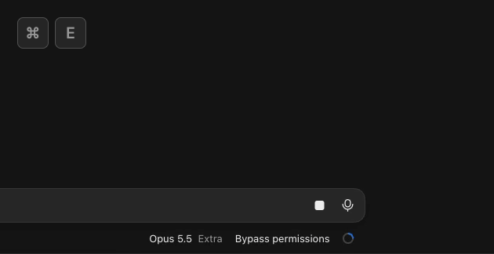

# CcEffortSwitch

English · [简体中文](README.zh-Hans.md)

CcEffortSwitch changes the effort level in the Claude desktop app the way ⌘Tab switches apps. Hold ⌘ and press E to open the Effort menu and move to the next level, press E again to keep moving down, and release ⌘ to select.



## Install

Requires macOS 15 or later. Supports Apple silicon.

Download and unzip `CcEffortSwitch-<version>.zip` from the [latest release](https://github.com/GooZhenJie/cc-effort-switch/releases/latest), then move **CcEffortSwitch** to **Applications**.

### First launch

The first time you open CcEffortSwitch, macOS may refuse to open it, saying it can't check the app for malware. When that happens, open **System Settings › Privacy & Security**, click **Open Anyway** under **Security**, click **Open Anyway** again when macOS asks, then use Touch ID or enter your password. See [Apple’s instructions](https://support.apple.com/guide/mac-help/open-a-mac-app-from-an-unknown-developer-mh40616/mac).

### Install from source

With Xcode installed:

```bash
git clone https://github.com/GooZhenJie/cc-effort-switch.git
cd cc-effort-switch
scripts/install-from-source.sh
```

## Using CcEffortSwitch

| Action | Keys |
| --- | --- |
| Open the Effort menu and move down | ⌘E |
| Move down | E or ↓, while holding ⌘ |
| Move up | ⇧E or ↑, while holding ⌘ |
| Select | Release ⌘ |
| Close without selecting | Esc |

Clicking, pressing any other key, or switching apps while the menu is open also closes the session without selecting. To keep the current level, press Esc before releasing ⌘. Holding E down does not repeat.

The menu bar icon shows the effort level of the Claude window in front, and updates when the level changes, including changes made with the mouse.

## Config file

Rules live in `~/.config/cc-effort-switch/config.jsonc`, which is created on first launch with a comment above each field. The `.jsonc` extension tells editors such as VS Code that the file is JSON with comments. Changes take effect when the file is saved. To use ⌥E instead of ⌘E, for example, change `hold` to `["option"]`.

```jsonc
{
  "rules": [
    {
      "name": "Claude effort",
      "application": "com.anthropic.claudefordesktop",
      "hold": ["command"],
      "key": "e",
      "open": [{ "key": "e", "modifiers": ["command", "shift"] }],
      "next": [{ "key": "down" }],
      "previous": [{ "key": "up" }],
      "select": [{ "key": "return" }],
      "cancel": [{ "key": "escape" }],
      "first": [{ "key": "home" }],
      "skip": ["Ultracode"],
      "menuTitle": "Effort"
    }
  ]
}
```

| Field | Meaning |
| --- | --- |
| `name` | The name of this rule. Error messages in the menu bar use it to say which rule has a problem. |
| `application` | Bundle identifier of the app. `osascript -e 'id of app "Claude"'` prints it. |
| `hold` | Modifiers held for the whole session: `command`, `shift`, `option`, `control`. |
| `key` | Pressed with `hold` to open the menu and move to the next item. Pressing it again moves down again; adding Shift moves to the previous item. |
| `open`, `next`, `previous`, `select`, `cancel` | Keys CcEffortSwitch sends to the app for each step. |
| `skip` | Menu items that are never selected. Remove `"Ultracode"` to allow it. CcEffortSwitch reads the open menu's items through Accessibility; if it can't, releasing the modifier selects nothing. |
| `first` | Keys that move to the first menu item. Required with `skip`. |
| `menuTitle` | Start of the open menu's title, so items are read from the right menu. In Claude the Effort menu sits inside the model menu. |
| `openDelayMilliseconds` | Wait after `open` before the first move. Default 100. |
| `selectDelayMilliseconds` | Wait after the modifier is released before `select`. Default 100. |

Key names are letters, digits, punctuation, `return`, `escape`, `tab`, `space`, `delete`, `forwarddelete`, `up`, `down`, `left`, `right`, `home`, `end`, `pageup`, `pagedown` and `f1` to `f12`. Keys are matched by their position on a US keyboard.

## Privacy

CcEffortSwitch has no accounts or analytics. It reads keystrokes only to find its own shortcuts and does not record them. The only network request is the update check, which CcEffortSwitch asks about on the second launch and you can turn off with **Check for Updates Automatically** in the menu bar icon.

## FAQ

### Pressing ⌘E does nothing

Make sure CcEffortSwitch is turned on in **System Settings › Privacy & Security › Accessibility**. CcEffortSwitch needs this permission to read and send keystrokes.

## License

MIT License. See [LICENSE](LICENSE).
