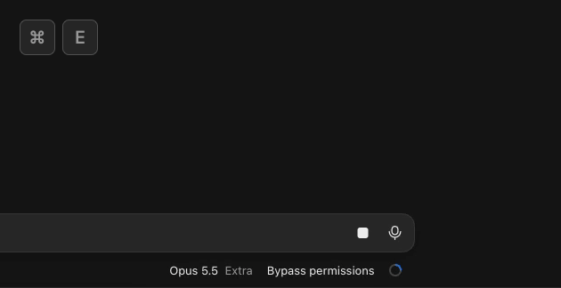

# CcEffortSwitch

[English](README.md) · 简体中文

CcEffortSwitch 让你像用 ⌘Tab 切换 App 一样，切换 Claude 桌面端的 effort 档位。按住 ⌘ 再按 E 会打开 Effort 菜单并移到下一档，继续按 E 往下移，松开 ⌘ 就选中。



## 安装

需要 macOS 15 或更新版本，支持 Apple 芯片。

从[最新版本](https://github.com/GooZhenJie/cc-effort-switch/releases/latest)下载 `CcEffortSwitch-<版本>.zip` 并解压，再把 **CcEffortSwitch** 移到「应用程序」文件夹。

### 第一次打开

第一次打开 CcEffortSwitch 时，macOS 可能会拒绝打开，提示无法检查它是否含有恶意软件。遇到这种情况，打开**系统设置 › 隐私与安全**（有的系统版本叫「隐私与安全性」），在**安全性**下面点**仍要打开**，macOS 再次询问时再点一次**仍要打开**，然后用触控ID 或输入密码。参见[苹果的说明](https://support.apple.com/zh-cn/guide/mac-help/mh40616/mac)。

### 从源码安装

装好 Xcode 后：

```bash
git clone https://github.com/GooZhenJie/cc-effort-switch.git
cd cc-effort-switch
scripts/install-from-source.sh
```

## 使用

| 操作 | 按键 |
| --- | --- |
| 打开 Effort 菜单并往下移一档 | ⌘E |
| 往下移 | 按住 ⌘ 时按 E 或 ↓ |
| 往上移 | 按住 ⌘ 时按 ⇧E 或 ↑ |
| 选中 | 松开 ⌘ |
| 关闭菜单，不选 | Esc |

菜单开着的时候，点鼠标、按别的键或切到别的 App，也会关掉菜单，不选任何一项。想保持原来的档位，在松开 ⌘ 之前按 Esc。按住 E 不放不会连续移动。

菜单栏图标会显示最前面那个 Claude 窗口的 effort 档位，档位变了图标跟着变，用鼠标换的也一样。

## 配置文件

规则存在 `~/.config/cc-effort-switch/config.jsonc`，第一次启动时自动生成，每一项上面都有英文注释。扩展名 `.jsonc` 让 VS Code 这类编辑器知道这是带注释的 JSON，不会把注释标成错误。存盘后立即生效。比如想把 ⌘E 改成 ⌥E，就把 `hold` 改成 `["option"]`。

```jsonc
{
  "rules": [
    {
      "name": "Claude effort",
      "application": "com.anthropic.claudefordesktop",
      "hold": ["command"],
      "key": "e",
      "open": [{ "key": "e", "modifiers": ["command", "shift"] }],
      "next": [{ "key": "down" }],
      "previous": [{ "key": "up" }],
      "select": [{ "key": "return" }],
      "cancel": [{ "key": "escape" }],
      "first": [{ "key": "home" }],
      "skip": ["Ultracode"],
      "menuTitle": "Effort"
    }
  ]
}
```

| 字段 | 作用 |
| --- | --- |
| `name` | 这条规则的名字。菜单栏里的报错用它指出是哪条规则出了问题。 |
| `application` | App 的 bundle ID。`osascript -e 'id of app "Claude"'` 可以查到。 |
| `hold` | 整个过程中按住的修饰键：`command`、`shift`、`option`、`control`。 |
| `key` | 和 `hold` 一起按下时打开菜单并移到下一项。再按一次继续往下移，加上 Shift 往上移。 |
| `open`、`next`、`previous`、`select`、`cancel` | 每一步发给 App 的按键。 |
| `skip` | 永远不会被选中的菜单项。删掉 `"Ultracode"` 就能选它。CcEffortSwitch 通过辅助功能读取打开的菜单里有哪些项，读不到时松开修饰键什么都不选。 |
| `first` | 跳到菜单第一项的按键。用了 `skip` 就必须写。 |
| `menuTitle` | 打开的菜单的标题开头，用来找到正确的菜单。Claude 的 Effort 菜单嵌在模型菜单里面。 |
| `openDelayMilliseconds` | 发出 `open` 后，等多久才开始移动。默认 100。 |
| `selectDelayMilliseconds` | 松开修饰键后，等多久才发 `select`。默认 100。 |

按键名称有字母、数字、标点，以及 `return`、`escape`、`tab`、`space`、`delete`、`forwarddelete`、`up`、`down`、`left`、`right`、`home`、`end`、`pageup`、`pagedown`、`f1` 到 `f12`。按键按美式键盘上的位置对应。

## 隐私

CcEffortSwitch 没有账号，不收集使用数据。它读取按键只是为了认出自己的快捷键，不会记录下来。唯一的网络请求是检查更新：第二次打开时 CcEffortSwitch 会问你要不要自动检查，之后也可以在菜单栏图标的菜单里用 **Check for Updates Automatically** 关掉。

## 常见问题

### 按 ⌘E 没反应

到**系统设置 › 隐私与安全 › 辅助功能**里确认 CcEffortSwitch 已经打开。CcEffortSwitch 要靠这个权限读取和发送按键。

## 许可证

MIT 许可证，见 [LICENSE](LICENSE)。
